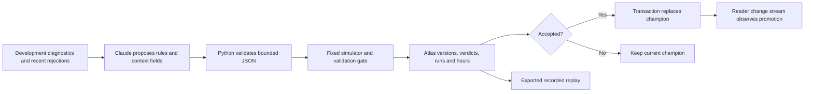
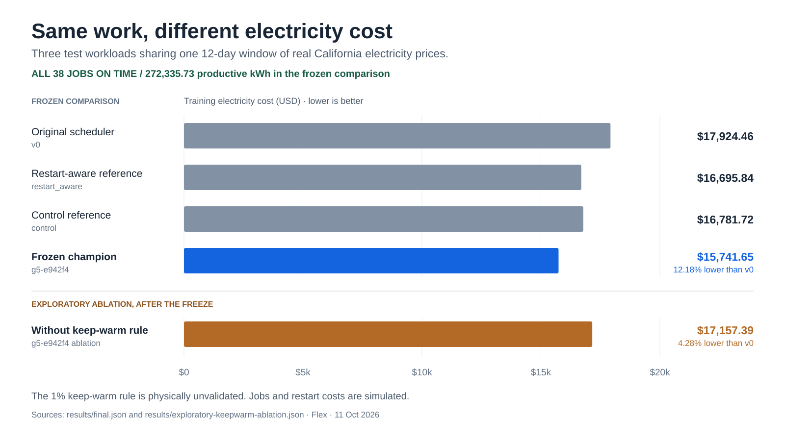

# Flex design

Flex repairs a simulated AI training scheduler when operating conditions change. Claude proposes scheduling rules. A fixed evaluator decides whether those rules qualify to replace the current champion, and MongoDB Atlas preserves the evidence and promotion history.

The measured repair went from 10 of 12 validation cases passing to 12 of 12 after simulated restart energy increased thirtyfold.

## What the agent can change

A policy is bounded JSON, with at most eight ordered rules, four conditions per rule, and 4,096 bytes. It selects observation fields and power levels between zero and one. Python validates the policy before evaluation. Generated policies cannot change the simulator, scenarios, or acceptance logic. No generated code is executed.

Acceptance and promotion are separate events. A candidate can pass evaluation before the database commits it as champion.

## How a change earns promotion

Each generation supplies Claude with development diagnostics and the five most recent rejections. The evaluator rejects a regression on any feasible validation case before considering a repair or cost improvement. Repairs may increase cost. A cost-only improvement must exceed one percent.

The first repair, `g1-289b1a`, expanded its observation fields from four to seven and changed the deadline margin and keep-running rules. The later `g4-4a14cc` proposal was 2.57% cheaper on validation, but introduced a late job-hour. The evaluator rejected it.

## Why persistence is part of the implementation

Hourly evidence uses Atlas time-series storage. Those writes cannot join a multi-document transaction. Each run writes evidence under a fresh attempt ID, updates the run-summary pointer, then prunes older attempts. Readers follow the pointer to a complete attempt. This recovery scheme assumes one writer per run ID.

A separate transaction retires the old champion, marks the new champion, and moves the champion pointer. The read-only change-stream watcher prints `PROMOTED` only for that pointer event.

Atlas validates version envelopes with `$jsonSchema`. Python enforces policy semantics. The supervisor can write the development database but cannot read the separate final database. The public website displays an exported replay and makes no live Atlas query.

## Where the evidence comes from

| Evidence | What it establishes |
| --- | --- |
| Development diagnostics | Information supplied to the supervisor. |
| Twelve validation cases | The 10/12 to 12/12 repair and the promotion gate. Repeated scoring provides selection feedback. |
| [Frozen comparison](results/final.json) | Cost across three workloads sharing one 12-day price window. Every pinned policy completed all 38 jobs on time. |
| [Keep-warm ablation](results/exploratory-keepwarm-ablation.json) | An exploratory check after the freeze. Removing one rule changes the result. |

The frozen champion saved 12.18% against the incumbent. Removing its physically unvalidated 1% keep-warm rule reduced savings to 4.28%, behind both references. The champion also has a disclosed two-hour development-case regression. These results establish behavior in this simulator. Prices are real; jobs, restart energy, and grid events are simulated.

## Implementation map

- [Evolution loop](flex/evolve.py) and [policy validation](flex/policy.py).
- [Acceptance gate](flex/evaluate.py), [simulator](flex/sim.py), and [frozen final evaluation](flex/final.py).
- [Evidence and promotion](flex/store.py), [watcher](flex/watch.py), and [database setup](db/setup.py).
- [Recorded replay](web/public/replay.json).

Final-price separation is procedural and uses a separate file and database role. The underlying prices are public. See the [README limitations](README.md#known-limitations) before interpreting the results.
